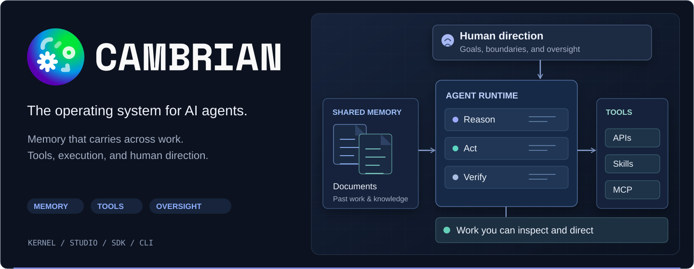
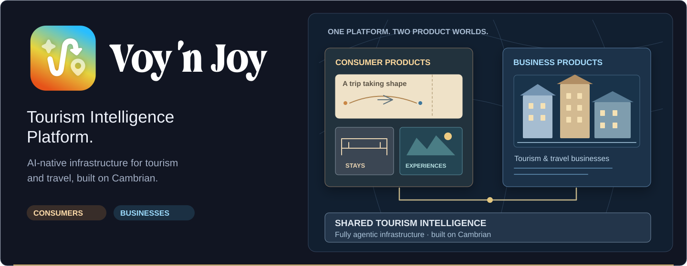
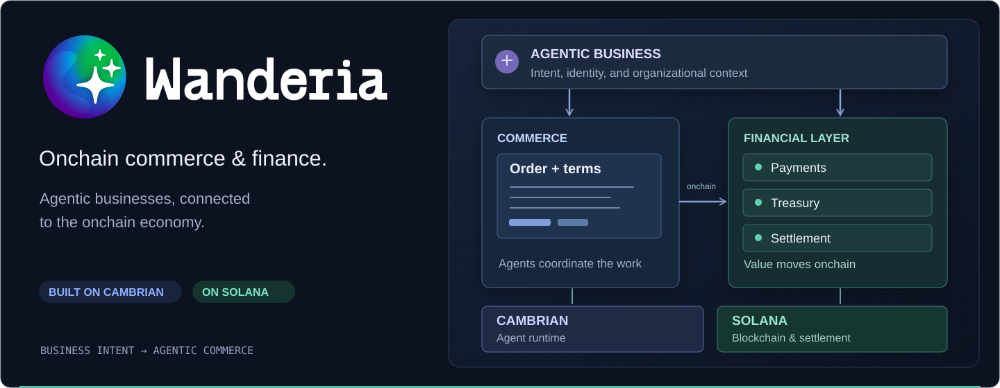
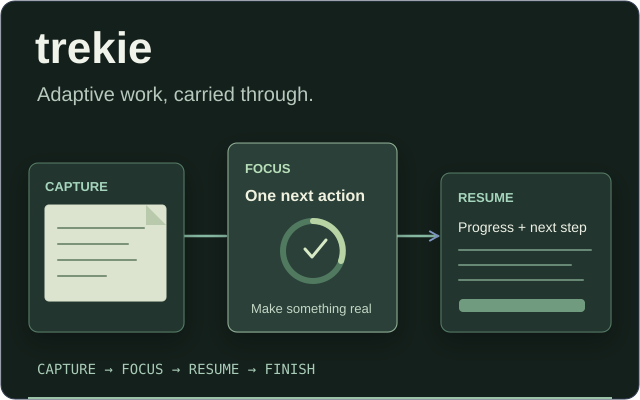
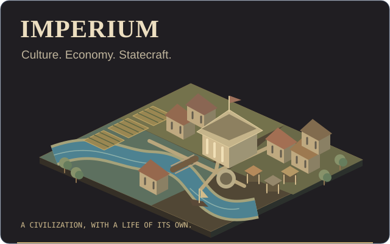

# Welcome 👋🏻

I'm building **[Cambrian](https://cambrian.sh)**, an applied AI research lab working on an open-core **operating system for AI agents**. Day to day I write a lot of Go, TypeScript and Python. I also do AI research at **Boğaziçi University** on how agents remember, reason, coordinate and act within boundaries.

Right now I mostly care about agentic AI, tools for thought, gamification and productivity.

`Founder` `Polymath` `Craftsman` • ENFJ • ♓ • 3w2 • 🤩📚💸💿💻⌨️🎙🎸🎶🎨🎭🏛🗽🛸

🌐 **Website: [doruk.dorkodu.com](https://doruk.dorkodu.com)**   
✉️ **Email: [doruk@dorkodu.com](mailto:doruk@dorkodu.com)**  
👥 **Social:** **[X](https://x.com/d0rukeray)** • [**Instagram**](https://instagram.com/d0rukeray) • [**LinkedIn**](https://linkedin.com/in/dorukeray) • [**Telegram**](https://t.me/dorukeray)

## NOW

### **Cambrian** *[(cambrian.sh)](https://cambrian.sh/)*

**The operating system for AI agents.** A runtime with memory, orchestration, trust, browser and tools built in, inspired by cognitive science and biology. The core is open; on top of it we're building a company brain for organizations, a cloud platform for developers and an app for everyday use.

`💼 Founder` `📅 2026` `📍 Istanbul, TR`

→ [core](https://github.com/cambrian-sh/core) (Go kernel) · [cli](https://github.com/cambrian-sh/cli) · [ui](https://github.com/cambrian-sh/ui) · [agent-sdk-python](https://github.com/cambrian-sh/agent-sdk-python) · [blog](https://github.com/cambrian-sh/blog)

### **UniCommons** *[(unicommons.net)](https://unicommons.net/)*

**The town square of academia.** It starts with admissions: verified graduate programme deadlines, so international applicants can find, track and apply to master's programmes in Europe.

`📅 2026` `📍 Istanbul, TR`

### **Voy ’N Joy** *[(voynjoy.com)](https://voynjoy.com/)*

**Tourism Intelligence Platform.** Built on **Cambrian**, Voy ’N Joy (VNJ) is a fully agentic, AI-native infrastructure for the **tourism and travel industry**, offering products for both **consumers and businesses**. It brings traveler experiences and business tools onto a shared intelligence layer.

`💼 CTO` `📅 2026` `📍 Istanbul, TR`

## BUILDING ON THE SIDE

### **Wanderia** *[(wanderia.xyz)](https://wanderia.xyz/)*

**The onchain commerce & financial layer for agentic businesses.** Built on **Cambrian** and the **Solana blockchain**, Wanderia connects agentic work with commerce and financial infrastructure, enabling businesses to operate through AI agents and transact onchain.

`💼 Founder` `📅 2025` `📍 Network State`

### **[Skald](https://github.com/cambrian-sh/skald)**

Project context and memory for coding agents: Claude Code, Codex and OpenCode. One command sets up guidance, session memory and structural code retrieval.

<table>
  <tr>
    <td width="50%" valign="top">
      
      <b><a href="https://github.com/dorukeray/trekie">Trekie</a></b> 
      Adaptive work for ambitious people. A gamified life dashboard and AI productivity companion.
    </td>
    <td width="50%" valign="top">
      
      <b>Imperium</b> 
      A civilization-simulation RTS I’m developing around culture, economy, and statecraft: shaping a society and governing its development.
    </td>
  </tr>
</table>

## RESEARCH & EDUCATION

🔬 **AI Research @ Boğaziçi University.** I run Cambrian's academic program on agent runtimes: capability-typed dispatch, agent memory and knowledge substrates, agent security and the token economics of harnesses.

🎓 **Boğaziçi University**: MA, Management Information Systems `⏳ 2027` · BA, Education Science `📅 2023 – 2027`

