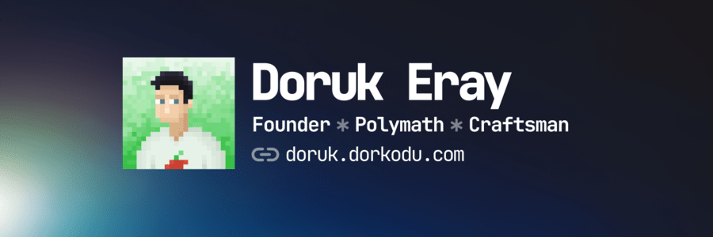

# Welcome 👋🏻

I'm building **[Cambrian](https://cambrian.sh)**, an applied AI research lab working on an open-core **operating system for AI agents**. Day to day I write a lot of Go, TypeScript and Python. I also do AI research at **Boğaziçi University** on how agents remember, reason, coordinate and act within boundaries.

Right now I mostly care about agentic AI, tools for thought, gamification and productivity.

`Founder` `Polymath` `Craftsman` • ENFJ • ♓ • 3w2 • 🤩📚💸💿💻⌨️🎙🎸🎶🎨🎭🏛🗽🛸

🌐 **Website: [doruk.dorkodu.com](https://doruk.dorkodu.com)**   
✉️ **Email: [doruk@dorkodu.com](mailto:doruk@dorkodu.com)**  
👥 **Social:** **[Twitter](https://twitter.com/d0rukeray)** • [**Instagram**](https://instagram.com/d0rukeray) • [**LinkedIn**](https://linkedin.com/in/dorukeray) • [**Telegram**](https://t.me/dorukeray)

## NOW

#### **Cambrian** *[(cambrian.sh)](https://cambrian.sh/)*
**The operating system for AI agents.** A runtime with memory, orchestration, trust, browser and tools built in, inspired by cognitive science and biology. The core is open; on top of it we're building a company brain for organizations, a cloud platform for developers and an app for everyday use.
`💼 Founder` `📅 2026` `📍 Istanbul, TR`

→ [core](https://github.com/cambrian-sh/core) (Go kernel) · [cli](https://github.com/cambrian-sh/cli) · [ui](https://github.com/cambrian-sh/ui) · [agent-sdk-python](https://github.com/cambrian-sh/agent-sdk-python) · [blog](https://github.com/cambrian-sh/blog)

#### **UniCommons** *[(unicommons.net)](https://unicommons.net/)*
**The town square of academia.** It starts with admissions: verified graduate programme deadlines, so international applicants can find, track and apply to master's programmes in Europe.
`📅 2026` `📍 Istanbul, TR`

#### **Voy 'N Joy** *[(voynjoy.com)](https://voynjoy.com/)*
**Your personalized AI travel assistant.** Plan your trip in one click. We book and manage where, when and how you go, so you can just enjoy it.
`💼 CTO` `📅 2026` `📍 Istanbul, TR`

## BUILDING ON THE SIDE

| Project | What it is |
| ------- | ---------- |
| **[Skald](https://github.com/cambrian-sh/skald)** | Project context and memory for coding agents: Claude Code, Codex and OpenCode. One command sets up guidance, session memory and structural code retrieval. |
| **[Trekie](https://github.com/dorukeray/trekie)** | Adaptive work for ambitious people. A gamified life dashboard and AI productivity companion. |

## RESEARCH & EDUCATION

🔬 **AI Research @ Boğaziçi University.** I run Cambrian's academic program on agent runtimes: capability-typed dispatch, agent memory and knowledge substrates, agent security and the token economics of harnesses.

🎓 **Boğaziçi University**: MA, Management Information Systems `⏳ 2027` · BA, Education Science `📅 2023 – 2027`

